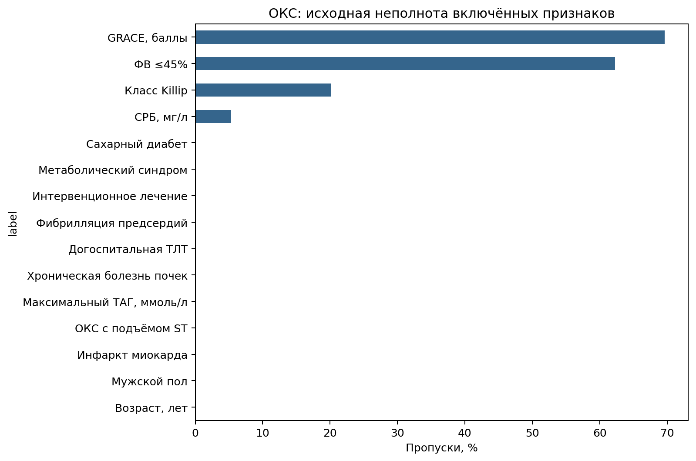
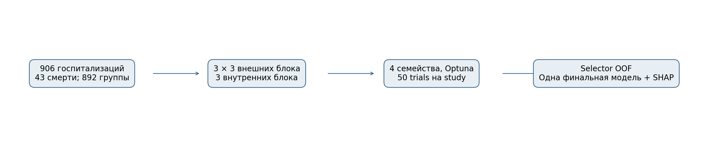
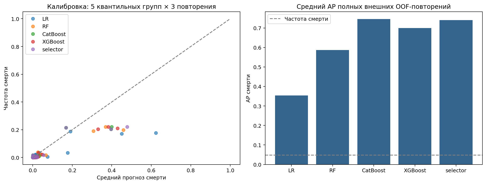
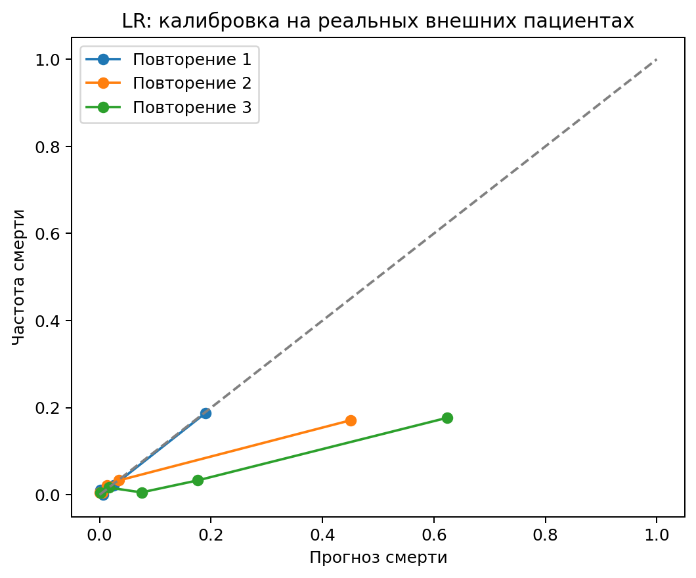
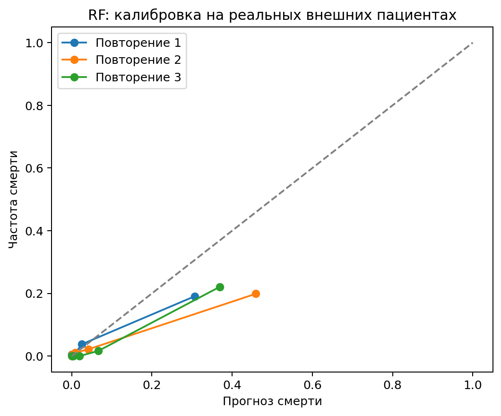
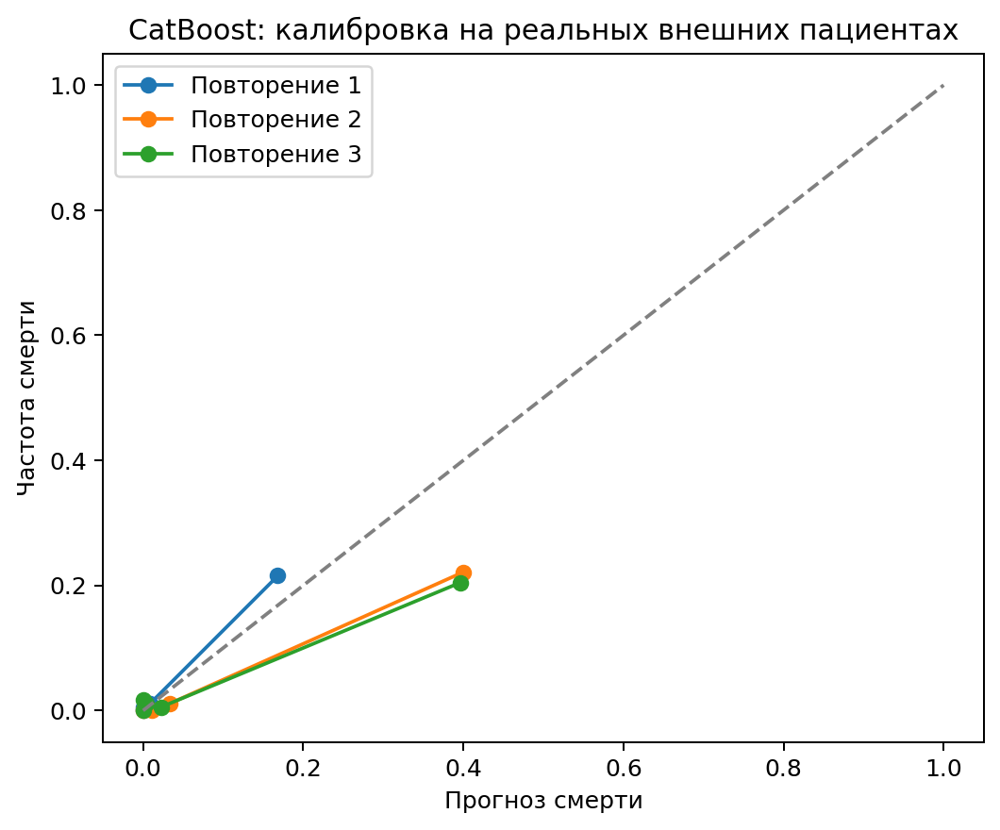
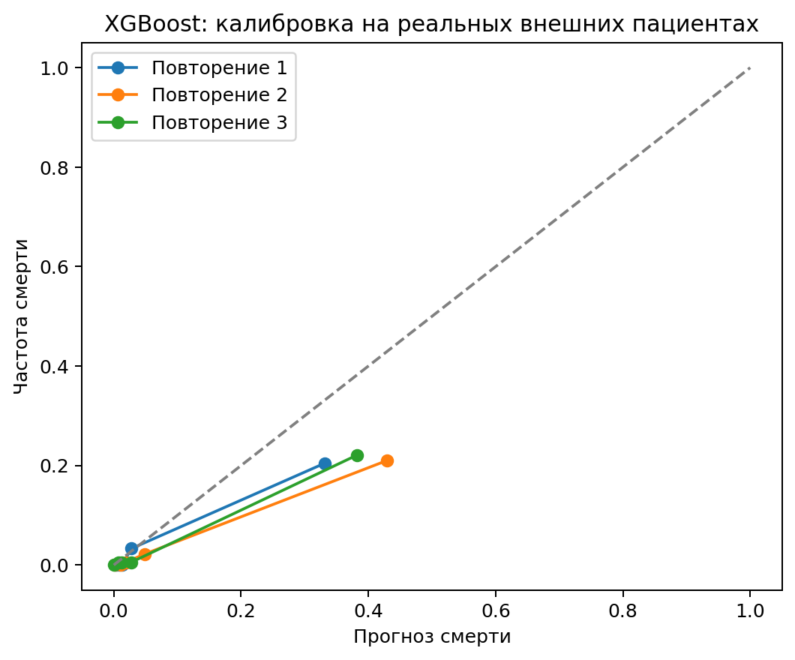
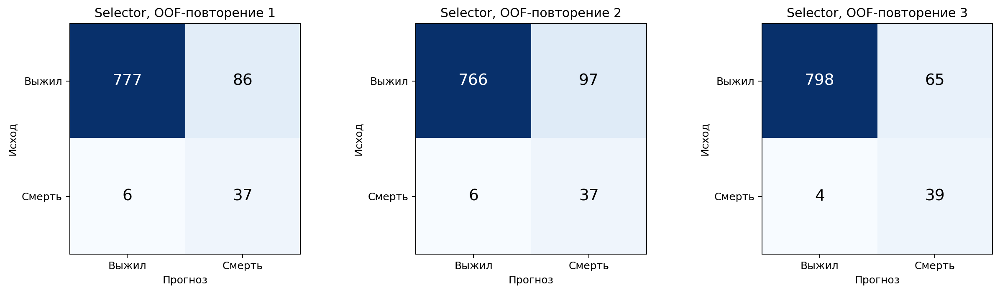
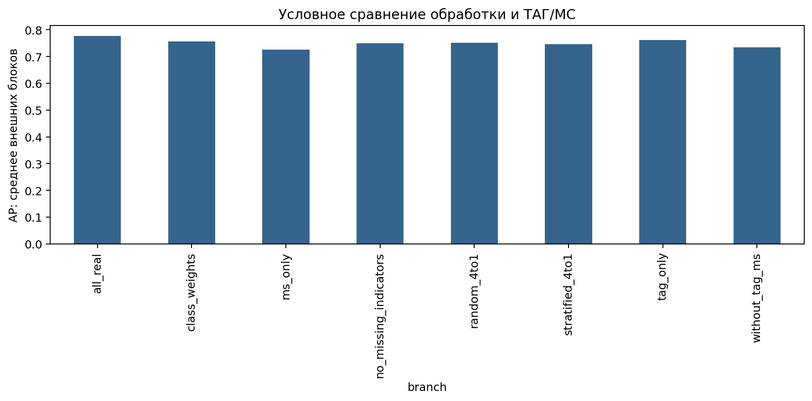
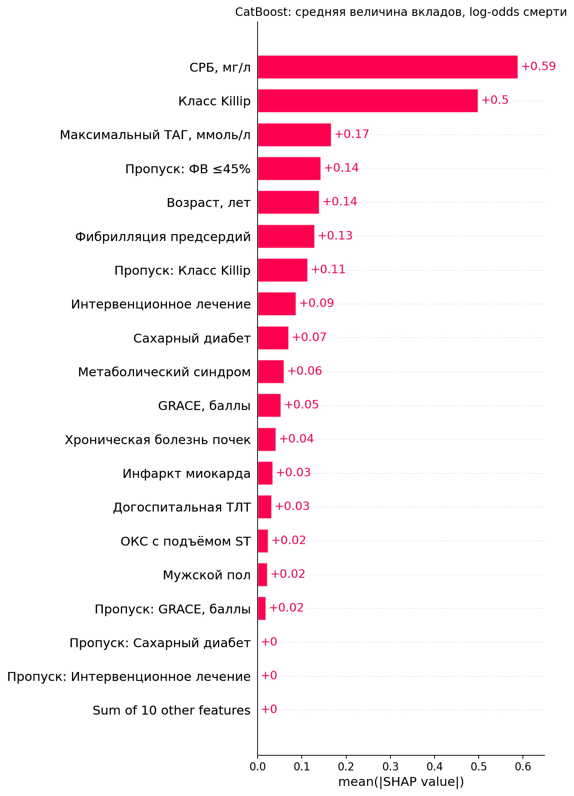

# ACS Research Projects

Исследовательский код для анализа острого коронарного синдрома (ОКС, Acute Coronary
Syndrome): статистический анализ, обработка дисбаланса классов, сравнение моделей
машинного обучения и объяснение прогнозов.

В репозитории сейчас представлено одно исследование: **прогностическая информация
триглицеридов и метаболического синдрома в отношении госпитальной смерти при ОКС**.
Каждую следующую работу можно добавлять самостоятельной папкой в `studies/`.
PDF/DOCX-отчёты, тезисы и их извлечённые тексты в репозиторий не включены.

## Исследовательская задача

Исходная работа автора рассматривает когорту госпитализаций с ОКС за 2023 год.
Задача — оценить связь максимального уровня триглицеридов (ТАГ) и метаболического
синдрома (МС) с исходом госпитализации и с определённой в исходном анализе группой
«экстремального риска», а также сопоставить способы обработки редкого летального исхода.

В ML-продолжении основной исход зафиксирован как госпитальная смерть. Сравниваются
четыре семейства моделей, оценивается весь процесс выбора модели и отдельно
исследуется добавочная информация ТАГ/МС. Это ретроспективное моделирование:
время максимального ТАГ, лабораторных измерений и вмешательств относительно исхода
не установлено. Возможность прогноза именно при поступлении не подтверждена.

| Показатель | Значение |
|---|---:|
| Госпитализации в аналитической когорте | 906 |
| Госпитальные смерти | 43 |
| Выжившие | 863 |
| Частота смерти | 4,746% |
| Группы для предотвращения пересечения повторных записей | 892 |
| Клинические признаки основной ML-модели | 15 |

906 — число записей госпитализаций; число уникальных физических лиц достоверно
не установлено. Группировка по нормализованным ФИО консервативна и допускает
совпадения имён и ошибки написания. Исход в старых ноутбуках: **0 — смерть,
1 — выжил**. В основной ML-матрице: **`hospital_death=1` — смерть**.

### Неполнота исходных признаков

График показывает долю пропусков до обучаемой импутации. Отсутствие записи
не приравнивается к отрицательному диагнозу или нормальному значению показателя.



## Структура

```text
acs-research-projects/
├── README.md
├── .gitignore
├── requirements.txt
├── pyproject.toml
├── src/acs_research/
│   ├── modeling.py              # Предобработка, семейства, Optuna и выбор
│   ├── paths.py                 # Переносимые пути и локальное хранение
│   └── validation.py            # Независимая сверка OOF и SHAP
├── scripts/
│   ├── run_analysis.py          # Последовательный запуск 01 → 02 → 03
│   ├── validate_results.py      # Проверка сохранённого вычислительного запуска
│   └── check_publication.py     # Проверка файлов, видимых Git
└── studies/acs/
    ├── README.md                # Данные, статистика и ограничения исследования
    ├── machine_learning/
    │   ├── README.md            # Подробный протокол, модели и интерпретация
    │   └── notebooks/
    │       ├── 01_данные_и_подготовка.ipynb
    │       ├── 02_модели_Optuna_и_эксперименты.ipynb
    │       └── 03_SHAP_и_итоги.ipynb
    ├── statistical_analysis/notebooks/
    │   ├── Analytics_1.ipynb     # Исходные статистика и ML автора
    │   └── Analytics_2.ipynb     # Балансировка, подгруппы и Random Forest
    ├── configs/                 # Протокол нового запуска и reference-снимки
    ├── data/
    │   ├── README.md
    │   └── private/             # Локальные CSV, исключены из Git
    ├── artifacts/private/       # Модели, SQLite, OOF, SHAP, исключены из Git
    ├── results/
    │   ├── tables/              # Проверенные агрегированные результаты
    │   ├── figures/             # Сводные графики
    │   └── archive/             # Исторические результаты с индикатором СРБ
    └── examples/                # Явно отмеченная синтетическая иллюстрация
```

В каталоге владельца локальные данные и артефакты подготовлены. После клонирования
с GitHub папок `private/` не будет. Код, настройки, сводки и фигуры доступны без них;
повторное обучение и сверка индивидуальных прогнозов требуют локальных CSV/артефактов.

## Машинное обучение

Основной маршрут — [три ML-ноутбука](studies/acs/machine_learning/notebooks/)
и [подробное описание протокола](studies/acs/machine_learning/README.md).

**Семейства:** L2-логистическая регрессия, Random Forest, CatBoost и XGBoost.
**Валидация:** 3 внешних групповых стратифицированных блока × 3 повторения,
по 3 внутренних блока. Все семейства используют общие внешние разбиения.
В каждом внешнем обучении Optuna TPE выполняет по 50 trials на семейство.
Финальный поиск на полной когорте также использует 50 trials на семейство.
Дополнительные условные эксперименты — 20 trials на ветвь и внешний блок.

Импутация, кодирование, масштабирование, подбор параметров, порога и балансировки
используют только текущие обучающие данные. Повторные записи одной группы не
пересекают train/validation/test. Внешняя проверка сохраняет естественную частоту смерти.
Выбор выполняется по среднему внутреннему Average Precision (AP) смерти;
при равенстве в пределах `1e-6` — по меньшему Brier, затем по фиксированному порядку
LR, RF, CatBoost, XGBoost. Порог максимизирует внутреннюю OOF balanced accuracy.

Отдельно оценивается **selector**: полная вложенная процедура, выбирающая семейство
по внутренним данным. Метрики selector описывают качество этой процедуры.
SHAP относится к окончательному артефакту, обученному с использованием всей когорты.

### Схема исследования

Подготовка когорты, вложенная проверка четырёх семейств, оценка selector и объяснение
одного окончательного артефакта образуют последовательные этапы анализа.



### Сохранённое качество

Числа ниже перенесены из завершённого запуска
`oks_no_crp_indicator_v2_d138be90f9f1`. Это средние трёх полных внешних
OOF-повторений, а не новый результат обучения после переорганизации репозитория.

| Процедура / настроенное семейство | AP смерти | ROC-AUC | Brier |
|---|---:|---:|---:|
| Logistic Regression | 0,35365 | 0,85270 | 0,06186 |
| Random Forest | 0,58726 | 0,92355 | 0,03599 |
| CatBoost | 0,74557 | 0,93833 | 0,02730 |
| XGBoost | 0,69995 | 0,95326 | 0,03067 |
| Selector | **0,74020** | **0,94090** | **0,03018** |

Полная таблица, включая baseline:
[сравнение моделей](studies/acs/results/tables/02_сравнение_моделей.csv).
Настройка Optuna не гарантирует улучшения: например, CatBoost baseline получил
AP 0,77362. Внешние метрики baseline не использовались для изменения правила
финального выбора. Разность tuned/baseline включает настройку обработки данных,
а не только гиперпараметров классификатора.



### Калибровка каждого семейства

Кривые сопоставляют среднюю прогнозируемую вероятность смерти и наблюдаемую
частоту смерти в группах внешних OOF-прогнозов. Диагональ соответствует их совпадению;
три линии на каждом графике относятся к трём повторениям. Это оценка калибровки
сохранённых прогнозов; дополнительная посткалибровка не выполнялась.

| Logistic Regression | Random Forest |
|---|---|
|  |  |

| CatBoost | XGBoost |
|---|---|
|  |  |

### Матрицы ошибок selector

Для каждого полного OOF-повторения показаны верные и ошибочные классификации
выживших и умерших. Предсказания получены на внешних записях; порог каждого блока
выбран по внутренним данным соответствующего обучения.



### Балансировка, пропуски и информация ТАГ/МС

Сравнение условных ветвей показывает влияние обработки дисбаланса, индикаторов
неполноты и состава признаков для глобально выбранного семейства. Высота столбцов
здесь — **средний AP внешних блоков**; она отличается от среднего AP полных
OOF-повторений в основной таблице. Эти оценки условны относительно выбора семейства.



Окончательно выбрано семейство **CatBoost** по внутреннему поиску на полной когорте.
Обучающий режим: стратифицированный отбор выживших до соотношения 4:1;
классификатор обучен на 215 записях, SHAP рассчитан для всех 906.
Текущий вариант сохраняет СРБ, но исключает отдельный бинарный индикатор его пропуска.
Конфигурация, порог и ограничения объяснения приведены в ML README.

### Глобальная важность признаков SHAP

Ранжирование отражает среднюю абсолютную величину вкладов в выход окончательной
модели CatBoost на 906 записях. Шкала — log-odds смерти. Большая величина вклада
не доказывает причинного влияния признака; СРБ включает также импутированные значения.



Все представленные графики взяты из сохранённого завершённого запуска.
Новые расчёты для оформления README не выполнялись.

## Воспроизведение

Проверенное исходное окружение использовало Python 3.11.15. `requirements.txt`
фиксирует фактически установленные версии зависимостей без локальных conda-путей.
Установка этих версий на другой ОС может зависеть от наличия подходящих wheels.

Из корня репозитория:

```bash
python3.11 -m venv .venv
source .venv/bin/activate
python -m pip install -r requirements.txt
python -m pip install --no-deps -e .
python -m ipykernel install --prefix .venv --name acs-research --display-name "Python (ACS Research)"
```

На Windows активация окружения: `.venv\Scripts\activate`. В Jupyter выбирайте
ядро установленного окружения. Для пересчёта разместите входные CSV согласно
[описанию данных](studies/acs/data/README.md), затем:

```bash
python scripts/run_analysis.py --step 01 --kernel acs-research
# Полный ML-поиск и bootstrap ресурсоёмки:
python scripts/run_analysis.py --step 02 --kernel acs-research
python scripts/run_analysis.py --step 03 --kernel acs-research
```

Можно использовать `--step all`. Выполненные копии ноутбуков и все результаты
сохраняются в `studies/acs/artifacts/private/runs/current/`; исходные ноутбуки
остаются без сохранённых outputs. Новый RUN_ID учитывает код, модуль моделей,
протокол, данные и версии. Завершённые studies одного RUN_ID используются повторно.

Для отдельного локального запуска установите `ACS_RUN_DIR=runs/my_run`.
Путь разрешён только внутри `artifacts/private/`. Исходный сохранённый запуск
в `artifacts/private/reference/` защищён от обычного пересчёта отдельным каталогом.

## Данные и подготовка к коммиту

В исходной таблице были ФИО, телефоны, номера историй болезни, точные даты,
сведения о месте жительства и работе. Они не перенесены в локальные входы.
Клинические признаки и исходы сохранены без изменения исследовательской задачи.
Порядковые коды групп сохраняют повторные записи; таблица соответствия ФИО отсутствует.

Оставшиеся клинические строки считаются **псевдонимизированными**, поэтому целиком
исключены из Git вместе с OOF, разбиениями, SHAP-массивами, моделями и базами Optuna.
Индивидуальные waterfall, scatter и beeswarm также остаются локальными.
Все публикуемые ноутбуки очищены от outputs, execution history и лишних метаданных.

Проверки и тесты не запускаются автоматически при сборке проекта. Это правило
зафиксировано в `AGENTS.md`. По отдельному запросу доступны
`scripts/check_publication.py` для проверки состава Git и `scripts/validate_results.py`
для локальной сверки сохранённого исследования:

```bash
python scripts/validate_results.py --run reference
```

Сверка пересчитывает метрики по OOF, проверяет групповые разбиения, selector,
финальный выбор, бюджеты trials, порядок признаков и аддитивность SHAP.
Она проверяет вычисления и не заменяет внешнюю клиническую валидацию.

## Ограничения

43 смерти ограничивают устойчивость подгрупповых оценок. Независимой внешней
когорты нет. Неизвестное время признаков ограничивает ранний прогноз; МС представлен
записанным диагнозом. Индикаторы неполноты и импутация могут отражать особенности
регистрации данных. SHAP объясняет модель и не устанавливает причины смерти.
Bootstrap-интервалы условны относительно фиксированных OOF и не учитывают полностью
неопределённость повторного обучения и глобального выбора семейства.

Исторический анализ автора и основной ML-протокол разделены. Результаты на заранее
сбалансированной выборке не сопоставимы напрямую с вложенной проверкой на полной
когорте. Иллюстрации с заданными средними/CV отдельно обозначены как синтетические.
Репозиторий содержит исследовательский код; клиническое применение моделей не проверено.
